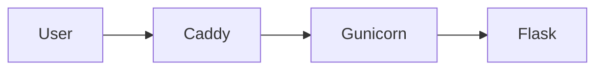

# Sistem Pengumpulan Tautan Beasiswa

Cloud Computing - PTI 2802
Pertemuan 3 - Project Inception

## Author
Asep Solihin / NIM 25832071001 / Kelas PTI 2A

## Problem
Informasi beasiswa tersebar di banyak sumber sehingga mahasiswa sulit
menemukan beasiswa yang valid dan masih dibuka.

## Target Users
Pengguna umum (mahasiswa) dan admin sebagai jaring pengaman.

## Features M03
- Baseline aplikasi Flask
- Health endpoint
- First VPS deployment

Fitur beasiswa (daftar, tambah, laporkan, sembunyi otomatis, admin)
direncanakan pada M05.

## Architecture

## Infrastructure
- Ubuntu Server 24.04, 2 vCPU, 1 GB RAM, 29 GB disk
- Caddy, Gunicorn, systemd, UFW

## Public Endpoint
`http://85.211.252.8/`

## Health Check
`GET /health`

## Deployment
Lihat `docs/deployment.md`.

## Security
- SSH key-only, root SSH dinonaktifkan
- UFW aktif
- Backend loopback-only

## Current Limitations
- HTTP only
- Belum ada database
- Belum ada container
- Deployment manual

## Roadmap
M04 DNS/HTTPS, M05 Data dan fitur beasiswa, M06 Container, M07 IaC, M09 CI/CD
