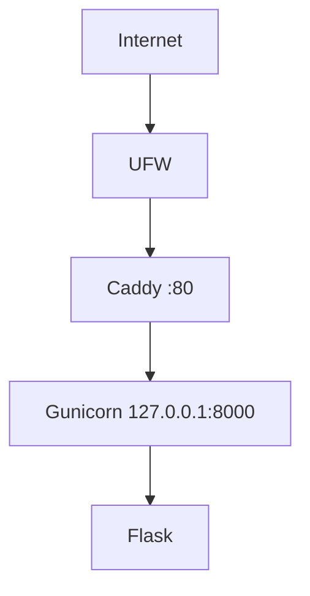
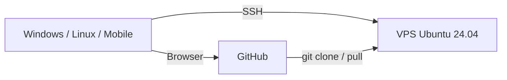
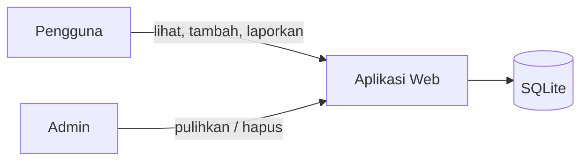

# Architecture v0.1 — Sistem Pengumpulan Tautan Beasiswa

## Deployment View

## Client - Repository - VPS

## Application Context (rencana, M05)

## Resource Constraints
- 2 vCPU (hasil nproc)
- 1 GB RAM (+1 GB swap sebagai safety buffer)
- Disk 29 GB

## Security Decisions
- Administrasi memakai user non-root (cloudstudent)
- SSH key authentication, password SSH dinonaktifkan
- Root login SSH dinonaktifkan
- UFW aktif, hanya OpenSSH dan 80/tcp dibuka
- Backend Gunicorn hanya listen di loopback

## Current Limitations
- HTTP only
- Single VPS
- Belum ada database
- Belum ada container
- Belum ada CI/CD

## Planned Evolution
- M04 DNS + HTTPS
- M05 Persistent data dan fitur beasiswa
- M06 Container
- M07 Infrastructure as Code
- M09 CI/CD
